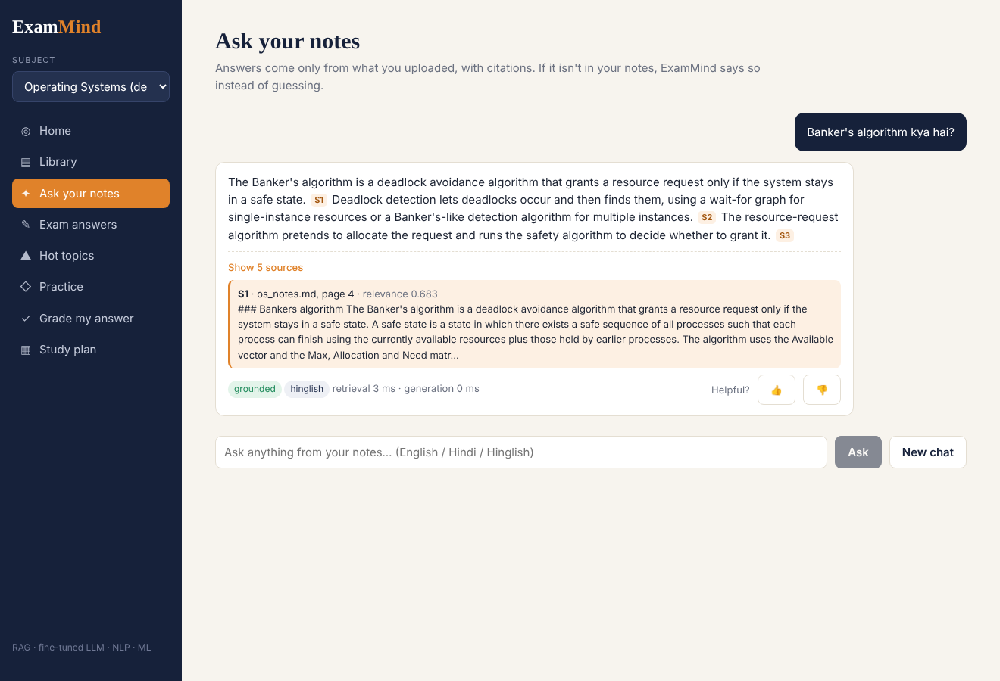
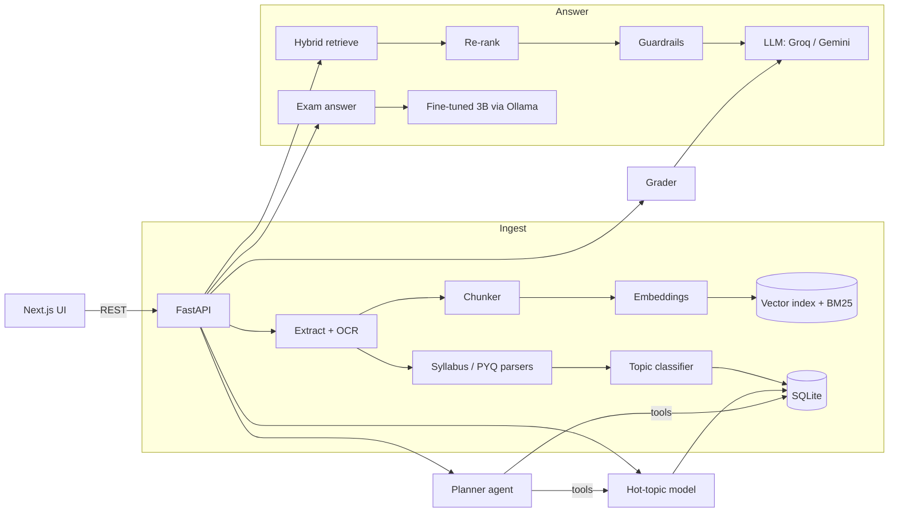

# ExamMind

**An AI exam-prep assistant for university students.** Upload your syllabus, notes and previous year papers. ExamMind answers doubts from *your* notes with citations, writes exam-style answers with a fine-tuned LLM, predicts which topics are likely this year, generates practice questions, grades your written answers and plans your revision with an AI agent.



## What's inside

| Feature | AI/ML concept | Code |
|---|---|---|
| Upload PDFs, scanned papers, photos | OCR (Tesseract), document parsing, sentence-aware chunking | `app/ingest/` |
| "Ask your notes" chat with page citations | **RAG**: multilingual embeddings, vector search, BM25, **hybrid search**, cross-encoder **re-ranking** | `app/rag/` |
| Refuses off-topic questions, ignores instructions hidden in PDFs | **Guardrails**: relevance threshold, prompt-injection scrubbing, citation validation | `app/rag/guardrails.py` |
| English / Hindi / Hinglish questions | Language detection, multilingual embeddings (e5 / MuRIL) | `app/nlp/language.py` |
| Auto-tag every past question by syllabus topic | **Text classification**: TF-IDF + LogReg baseline, then a **fine-tuned DistilBERT/MuRIL** | `app/nlp/classifier.py`, `training/classifier/` |
| Definitions, formulas, key terms from notes | Classic NLP: TF-IDF, pattern-based extraction | `app/nlp/keyterms.py` |
| "Hot topics this year" with reasons | **Classical ML**: feature engineering on paper history, gradient boosting, back-testing | `app/ml/topic_predictor.py` |
| Exam answers sized for 2 / 5 / 10 marks | **LLM fine-tuning**: QLoRA on a 3B model, distilled from a 70B teacher, GGUF-quantised, served by Ollama | `app/generation/exam.py`, `training/llm/` |
| MCQs and short questions from any chapter | Structured generation (JSON mode), output validation | `app/generation/exam.py` |
| Grade my written answer | Semantic similarity + keyword coverage + **LLM-as-judge** rubric | `app/generation/grader.py` |
| Study plan | **AI agent** with JSON tool calling (ReAct-style loop) | `app/agent/planner.py` |
| 👍 / 👎 on answers, fixing wrong topic tags | **Human feedback loop**: corrections become gold training labels | `api/routes.py` |
| Benchmarks | RAG eval (Hit@k, MRR, faithfulness, refusal), classifier eval, base vs fine-tuned LLM eval | `backend/eval/`, `training/` |

## Architecture



## Quick start

**1. Backend** (Python 3.11+)

```bash
cd backend
python -m venv .venv && source .venv/bin/activate
pip install -r requirements.txt
pip install -r requirements-ml.txt        # recommended: real embeddings + re-ranker + OCR support
cp .env.example .env                      # add a free GROQ_API_KEY or GEMINI_API_KEY
uvicorn app.main:app --reload             # http://localhost:8000/docs
```

No API key yet? Set `LLM_PROVIDER=mock` and `EMBEDDING_PROVIDER=hash` in `.env`. Everything runs offline with a deterministic mock model, which is useful for development and tests.

For OCR on scanned papers, also install the binaries: `brew install tesseract poppler` (macOS) or `apt install tesseract-ocr poppler-utils`.

**2. Frontend** (Node 20+)

```bash
cd frontend
npm install
npm run dev                               # http://localhost:3000
```

Click **Load OS demo** on the home page. It loads a sample Operating Systems syllabus, notes and 7 years of (synthetic) past papers so every feature works right away.

**Or with Docker:** `cp backend/.env.example backend/.env` (add a key), then `docker compose up --build`.

**3. Tests**

```bash
cd backend && pytest -q                   # 19 tests, fully offline
```

## Fine-tuning your own models

See **[training/README.md](training/README.md)**. Both models train on free Kaggle/Colab GPUs:

1. **Topic classifier**: `python train_classifier.py --model google/muril-base-cased` (~5 min).
2. **Exam-answer LLM**: build a distillation dataset with a 70B teacher, run QLoRA on a 3B model in a Kaggle notebook (~30 min), export to GGUF, then `ollama create exammind -f Modelfile` and set `ANSWER_LLM_PROVIDER=ollama`.
3. **Benchmark** base vs fine-tuned: `python ../training/llm/evaluate_finetune.py --models ollama:qwen2.5:3b ollama:exammind groq`.

## Benchmarks

**RAG evaluation** (`python -m eval.rag_eval`): 26 labelled questions (including Hinglish) plus 5 off-topic questions.
The numbers below are the **offline baseline** (hash embeddings, lexical re-ranker, mock LLM). Re-run with real embeddings and an LLM key and replace them; that comparison is the story to tell.

| config | Hit@1 | Recall@5 | MRR | off-topic refusal |
|---|---|---|---|---|
| BM25 only | 0.808 | 1.0 | 0.888 | 1.0 |
| Dense only | 0.692 | 0.962 | 0.795 | 0.0 |
| Hybrid | 0.769 | 1.0 | 0.875 | 0.6 |
| **Hybrid + rerank** | **0.808** | **1.0** | **0.894** | **1.0** |

**Topic classifier** (train on 2019–23 papers, test on 2024–25): TF-IDF baseline 0.839 accuracy, rising to **0.935** with synthetic augmentation. Fine-tuned transformer: run `training/classifier` to fill this in.

**Hot-topic model**: back-tested on the most recent paper and shown in the UI (precision@k, AUC). The sample data is synthetic, so treat the demo numbers as a pipeline check, not a claim. Use real IKGPTU papers for real numbers.

## API

Interactive docs at `http://localhost:8000/docs`. Main endpoints (all under `/api/subjects/{id}`):

`POST /documents` (upload: kind = notes | syllabus | pyq) · `POST /chat` · `POST /answer` · `POST /summarize` · `POST /practice` · `POST /grade` · `POST /plan` · `GET /hot-topics` · `GET /questions` · `PUT /questions/{qid}` (fix a tag) · `POST /classify` · `GET /keyterms` · `POST /api/feedback`

## Project structure

```
backend/
  app/
    llm/          providers (Groq, Gemini, Ollama, mock) + JSON helpers
    ingest/       extraction, OCR, chunking, syllabus & PYQ parsers
    rag/          embeddings, hybrid index, re-ranker, guardrails, pipeline
    nlp/          language detection, topic classifier, key terms
    ml/           hot-topic predictor
    generation/   exam answers, summaries, MCQs, grader
    agent/        study-plan agent + tools
    api/          FastAPI routes
  eval/           RAG benchmark + labelled eval set
  tests/          pytest (offline)
training/
  classifier/     transformer fine-tuning + baselines
  llm/            SFT dataset builder, QLoRA script, Modelfile, evaluation
frontend/         Next.js 15 app (App Router, TypeScript)
data/sample/      demo syllabus, notes, synthetic PYQ generator
```

## Design decisions (interview notes)

- **Hybrid search + re-ranking.** BM25 catches exact terms ("Banker's", "LRU"), embeddings catch meaning and Hinglish paraphrases, and a cross-encoder re-ranks the top 20 for precision. The eval table shows what each stage adds.
- **BM25 is normalised against an "ideal" match, not the top hit.** Normalising by the best hit made every off-topic question look like a perfect match and broke the "not in your notes" guardrail. A failing off-topic test caught this.
- **Uploaded files are untrusted.** Retrieved text is scrubbed for injected instructions and the system prompt tells the model to treat sources as data, not commands. A test covers this.
- **Distillation instead of hand-labelling.** A 70B teacher writes grounded exam answers that pass quality filters, and a 3B student learns the format. Same prompt at train and inference time; loss on responses only.
- **The agent decides, deterministic tools compute.** The LLM chooses which tools to call and writes the message, but hours and days come from code, so the plan can't contain arithmetic errors.
- **Blended grading.** An LLM judge alone can be inconsistent and keyword matching alone can be gamed, so the grade blends both with semantic similarity.

## Roadmap

- [ ] Fine-tune and benchmark on real IKGPTU papers for 3–4 subjects
- [ ] Diagrams: extract figures from PDFs, multimodal answers
- [ ] Auth + multi-user, Postgres + pgvector
- [ ] DPO on 👍/👎 feedback pairs

## License

MIT
